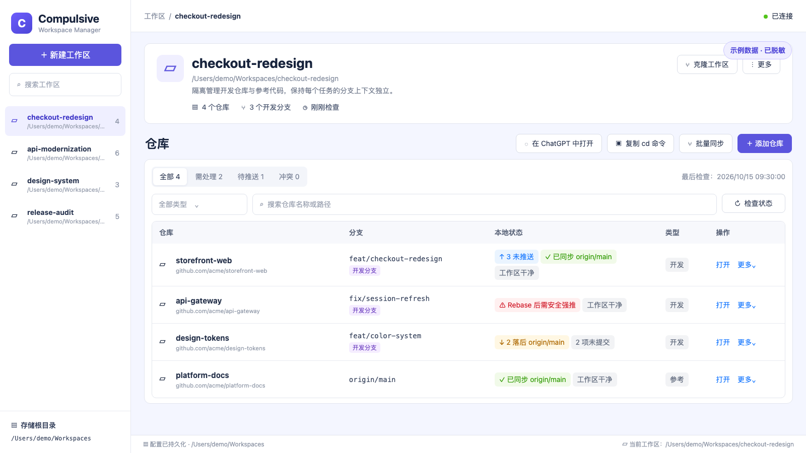

# Compulsive

[English](./README.md) · 简体中文

**AI 时代的仓库管家。**

AI 已经改变了软件开发。一个开发者现在可以同时探索更多框架、运行更多实验，并维护大量
由 Agent 协助生成的项目。瓶颈不再是创建仓库，而是记住每个仓库放在哪里、需要时快速找到
它，以及在不重复 clone、不丢失工作的前提下组织相关项目。

Compulsive 是一个面向 macOS 的本地 Git 仓库管理工具。它通过 `cpl` 命令为每个仓库提供
可预测的 canonical 位置，让所有仓库都可搜索，并允许多个 Workspace 通过链接或隔离的
Git worktree 复用同一个仓库。

## 核心能力

- 按 `<host>/<owner...>/<repo>` 自动分类远程仓库。
- 将无 remote 仓库统一归入 `local/<repo>`。
- 发现和登记已有仓库，不擅自移动文件。
- 移动前预演，并保护脏仓库、嵌套仓库和已占用目标。
- 在脚本或交互终端中搜索仓库与 Workspace。
- 让多个 Workspace 复用同一个 canonical 仓库，避免重复 clone。
- clone、跳转或整理后复制安全的 `cd -- 'path'` 命令。

## 安装

```bash
npm install --global @adrian-zephyr/compulsive
cpl init
```

初始化还会向 `~/.codex/AGENTS.md` 写入一段带标记的 CPL 工作流说明。标记外的已有内容会原样
保留；重复执行 `cpl init` 会安全刷新这段说明。

首次初始化时可以指定管理根目录：

```bash
cpl init --root /Users/your-name/Code
```

初始化操作是幂等的。重复执行不会覆盖现有根目录或仓库索引。

## 目录规则

远程仓库按照主机、所有者路径和仓库名称分类：

```text
/Users/your-name/Code/github.com/vuejs/core
/Users/your-name/Code/gitlab.com/group/subgroup/project
```

没有 `origin` 远程地址的仓库使用 `local/<repository>` 逻辑分类。在明确确认
`cpl organize` 之前，仓库始终保留在原位置。

## 命令

```bash
cpl clone https://github.com/vuejs/core.git
cpl add /Users/your-name/Projects/my-local-tool
cpl scan /Users/your-name/Projects
cpl scan /Users/your-name/Projects --register
cpl list
cpl list core --json
cpl search core
cpl search core --json
cpl search frontend --workspace Product
cpl go core
cpl organize my-local-tool --dry-run
cpl organize my-local-tool --yes
cpl organize --all --dry-run
cpl organize --all --yes
cpl forget my-local-tool --yes
cpl doctor
```

`clone`、`go` 和执行成功的 `organize` 会把安全转义后的 `cd -- 'path'` 命令复制到
macOS 剪贴板并打印出来。剪贴板不可用时只会显示警告，不会把成功的 Git 操作判定为失败。

`scan` 默认只预览，只有传入 `--register` 才会登记仓库。扫描结果只显示尚未登记的新仓库，
因此迁移完成后重复执行不会再次列出已经归位的仓库。`forget` 仅删除索引记录，绝不删除仓库文件。

### 本地编辑器

在需求的仓库操作列点击「打开编辑器」，进入参考 [Mayoi](https://github.com/sorrycc/Mayoi)
交互设计的本地工作台。沿用 React、Ant Design、CodeMirror 6 与 xterm.js，不复制其原生运行时，
也不接入 SSH 或账号云同步。

- 编辑保存、新建文件 / 文件夹、重命名 / 移动，以及移到系统废纸篓。
- 默认进入「变更 Diff」，审阅本地已保存的暂存、未暂存和新增文件；需要时切换「全部文件」，
  未保存编辑会保留。这里不是整个需求分支相对远端主分支的对比。
- `Cmd/Ctrl+P` 打开文件，`Cmd/Ctrl+Shift+P` 打开命令面板，`Cmd/Ctrl+S` 保存，
  `Cmd/Ctrl+\\` 分栏，`Cmd/Ctrl+F` 在文件内查找。
- 跨文件搜索与替换预览、独立编辑分栏、Markdown / SVG / 图片预览，以及手动 Git 检查、
  暂存、差异、提交历史与分支操作。
- 「撤销所有变更」清理暂存、未暂存和未跟踪改动，忽略文件和提交保留。**默认不备份**，需再次确认
  永久丢弃风险；可勾选「保留 Git stash 备份」，完成后提供恢复命令。需先保存编辑并暂停外部写入；
  冲突、未完成的 Git 操作及不安全 / 排除文件会阻止两种模式执行。
- 「Codex 生成说明」经确认后仅发送已暂存的补丁，回填提交说明供你检查。使用已安装并登录的
  CLI 默认模型，不加载自定义配置或项目上下文；不会自动暂存、提交或推送。
- 主动启动真实本地终端。**终端不是沙箱**：以当前系统用户权限运行，初始目录为所选仓库，
  但可以访问机器上的其他目录。请仅在信任项目时启动。
- 在页头或编辑器偏好中切换**全局亮 / 暗模式**，需求、系统设置、编辑器及弹层使用同一主题，
  选择保存在 CPL 配置旁的 `devtool-preferences.json`。字体、换行、Vim、主动开启的自动保存及布局
  仍保存在 `editor-sessions.json`；不保存源码内容或终端输出。

保存会核对读取时的内容版本，外部修改会阻止覆盖；关闭未保存标签或离开页面时需要明确选择。
文件事件会刷新干净文档，Git 状态仍由用户主动检查，不轮询。终端关闭或服务退出时会结束进程，
没有连接的终端会在 20 分钟后过期。除明确确认将已暂存补丁发送给 Codex 生成说明外，文件内容均留在本地。

文件接口仅访问需求当前关联的仓库，不跟随软链接，不提供 Git 元数据、依赖 / worktree 目录及
常见环境变量 / 密钥文件；这些排除规则不是完整的密钥检测器。UTF-8 文本与图片限 4 MiB，
每个目录最多检查 1000 项，截断时明确提示。超出范围时可使用「在 VS Code 中打开」。
移到废纸篓使用 macOS 15+ 的系统 `trash` 命令；系统不提供该命令时会阻止删除，改由文件管理器处理。

### Worktree 巡检

在「系统设置 → 环境诊断 → Worktree 巡检」手动运行，或使用：

```bash
cpl doctor worktrees
cpl doctor worktrees --all --json
```

巡检交叉核对 CPL 需求引用、Git 登记和托管仓库 `.worktrees` 下的直接子目录，排除主工作副本，
区分需求使用中、托管目录内未引用、外部归属待确认、路径缺失和磁盘未登记目录。详情保留
已跟踪 / 未跟踪 / 忽略文件、冲突、未完成的 Git 操作、锁定原因、HEAD 和未发布提交等证据。
远端比较仅使用**本地缓存引用**，不会 fetch、删除或 prune。**未引用、工作区干净都不代表可删除**；
路径缺失也可能是目录移动或磁盘离线。

扫描支持进度和主动停止；中断或失败会明确标记报告不完整。报告与忽略记录保存在 CPL
`config.json` 同目录的 `worktree-audit.json` 和 `worktree-audit-ignores.json`，不用浏览器存储。
「保留并忽略」只隐藏当前指纹的结果，后续巡检发现 HEAD、文件或风险变化时会恢复提醒。
页面支持查看详情、在 VS Code 打开仍登记的目录和本地导出 JSON（包含本地路径及文件名）。
原有 `cpl doctor --json` 的检查数组格式保持不变。

需要清理时，在巡检表格选择「删除 Worktree」。CPL 会重新检查实时状态，并要求输入完整路径
确认。所有候选都可打开确认窗口；有变更、冲突、锁定、需求引用、未完成 Git 操作、子模块、
缺失登记或未登记目录时，必须额外勾选「强制删除」。登记按目标逐项移除，不执行批量 prune；
未登记目录仅在显式强制确认后递归删除，软链接仅删除链接本身、不跟随目标。
主 / 规范仓库、受保护根目录及身份变化的路径仍不能通过强制选项绕过。

本地分支保留；分离 HEAD 的提交在强制删除前写入 `refs/cpl/removed-worktrees/` 恢复引用，
可用界面给出的引用重新创建分支。删除后同步移除受影响的需求成员关联及受管软链接。
忽略文件 / 目录仍需独立勾选授权（可能包含本地配置或密钥），忽略目录按目录汇总、不逐文件审核。
强制删除会永久丢弃未提交 / 未跟踪数据和未完成操作，不进入废纸篓；确认前先停止编辑和运行任务。
普通需求成员删除仍保留原有的工作树干净检查。

在交互终端中直接运行 `cpl`，会打开支持键入过滤的仓库与 Workspace 混合选择器；
`cpl search` 只搜索仓库，`cpl workspace` 只搜索 Workspace。选择目标后会复制并打印安全的
`cd` 命令。脚本和管道环境不会显示交互提示。

运行本地 Workspace DevTool，可以创建 Workspace、按任务加入所需仓库、同步 worktree，并复制
最终的 `cd` 命令：

```bash
cpl ui
```

DevTool 通过 Devframe 在 localhost 提供带认证的页面，并自动打开浏览器。使用
`cpl ui --no-open` 可以只启动服务、不新开标签页。

## Workspace DevTool

DevTool 是面向日常任务的 Workspace 控制台。仓库表格保留主要查看空间，常用操作集中在表格
上方；远端状态不会后台轮询，只在用户主动检查时更新。



_截图中的工作区、仓库、远端地址、分支和磁盘路径均为虚构示例。_

可以通过界面完成：

- 新建 Workspace，或从现有 Workspace 中选择部分仓库进行克隆。
- 将仓库作为隔离的开发 worktree 或 detached 参考代码加入 Workspace。
- 指定、创建并随时切换开发分支；远端存在同名分支时自动建立跟踪关系。
- 按任务需要在参考代码与开发 worktree 之间双向转换。
- 从远端默认分支刷新参考代码，同时保持 detached，不额外创建本地分支。
- 新建、复制需求及添加仓库时，可逐仓库选择「主分支开发」，自动识别 origin 默认分支，不创建需求分支；已被其他 worktree 占用的分支不会被强制抢占。
- 检查未提交文件、冲突、相对主分支的领先/落后、未推送提交，以及远端开发分支是否已经
  合入主分支。
- 批量同步开发分支，自动 stash、rebase 和 push，并按仓库列出跳过、失败、冲突或需安全强推的原因。
- 随时在 VS Code 中打开仓库、在 ChatGPT 中打开 Workspace，或把冲突交给具备完整文件访问
  权限的独立 Codex 聊天处理。

最近一次检查结果会与 CPL 配置一起持久化，关闭浏览器或重启 DevTool 后仍然保留。需要最新
远端状态时，主动点击**检查状态**即可。

### Rebase 与 Push 安全

批量同步会先 stash 已暂存、未暂存和未跟踪的改动（包括二进制文件），获取远端默认主分支
（`origin/master` 或 `origin/main`）。为保留他人提交，必要时先 rebase 同名远端分支，再 rebase
主分支并 push，最后恢复本地改动及暂存状态；这些未提交改动不会被自动提交或推送。
参考代码仍以 detached 状态更新。存在未完成 Git 操作时会阻止同步；rebase 冲突时停止该仓库的
推送，通过「处理冲突」选择 VS Code 或主动交给 Codex。结果会给出准确的 stash 备份及恢复状态。
恢复待处理备份前请先检查现场；部分恢复失败后不要重复 apply。即使恢复成功，备份也仍保留在
Git stash，CPL 不会自动删除新旧 stash。

普通分支分叉会先同步远端同名分支，再执行常规 Push。如果基于远端主分支 Rebase 后改写了
已经推送过的提交，DevTool 会记录 Rebase 前的远端提交，显示红色的**Rebase 后需安全强推**
状态，并阻止普通 Push。用户确认后，CPL 才会执行绑定该提交 SHA 的
`--force-with-lease`；如果远端随后又出现新提交，Git 会拒绝推送，不会覆盖他人代码。
重复 Rebase 或重新选择当前分支，都不会刷新或清除这份保护基线。
批量同步不会自动强推。手动确认安全强推时，同样会暂存并恢复本地改动，避免恢复开发现场后
无法完成已确认的推送。
如果同名远端分支存在本地和 Rebase 目标都未包含的提交，需要先同步该分支；CPL 不会授权覆盖
这些未合并的提交。在主分支上开发且目标已包含远端提交时，仍可正常快进更新。

批量迁移时，先登记扫描结果，再统一预演全部目标路径：

```bash
cpl scan /Users/your-name/Projects --register
cpl organize --all --dry-run
cpl organize --all --yes
```

`organize --all` 会重新读取每个仓库当前的 `origin`，但只输出规范目标发生变化、确实需要移动的
仓库。原先登记在 `local/` 下的项目新增 `origin` 后，会自动提升到 `github.com/...` 分类。
dry-run 不会更新索引；只有确认移动成功后才会保存新分类。所有仓库仍会参与预检，因此任意目标
冲突都会在第一次移动前中止批次。执行过程中遇到意外文件系统错误时会停止处理后续仓库，批量模式
也不会反复覆盖剪贴板。

## Workspace

Workspace 是相关项目的组合目录，不改变仓库的规范存储位置。默认目录是仓库管理根目录的
同级 `Workspaces`，例如 `/Users/your-name/Code` 对应
`/Users/your-name/Workspaces`。

Workspace 成员默认使用独立 Git worktree。不传 `--branch` 时，Compulsive 会从 canonical
仓库当前提交创建 `workspace/<workspace>/<alias>` 分支：

```bash
cpl workspace create Product
cpl workspace create Platform
cpl workspace add Product api
cpl workspace add Platform api --alias shared-api
cpl workspace list
cpl workspace show Product
cpl workspace go Product
cpl search shared --workspace Platform
```

复用现有分支时显式传入 `--branch`：

```bash
cpl workspace add Product web --branch feature/product-web
```

创建新分支必须同时提供 `--create-branch`，分支名会严格使用 `--branch` 的原值：

```bash
cpl workspace add Product worker \
  --branch feature/product-worker \
  --create-branch
```

实体 worktree 保存在 `<canonical-repository>/.worktrees/<workspace>`，Workspace 成员只是指向
它的绝对软链接。使用 `--create-branch` 时，如果 `origin` 已有同名分支，Compulsive 会先获取
并跟踪该分支；否则才从指定起点或当前提交创建不带 upstream 的本地分支。

常用维护命令：

```bash
cpl workspace sync Product
cpl workspace migrate --yes
cpl workspace remove Product api --yes
cpl workspace delete Product --yes
```

`workspace remove` 只删除选中的 Compulsive 管理链接或干净 worktree；`workspace delete`
会在确认所有托管 worktree 干净后，永久删除整个已注册 Workspace 目录。两者都不会删除
canonical 仓库；受保护路径、脏 worktree 和嵌套注册的 Workspace 会阻止删除。
`workspace` 可以缩写为 `ws`。
旧版本直接建在 Workspace 下的 worktree 可用 `workspace migrate` 原位迁移；命令保留未提交
修改，并在成功移动后把旧路径替换为软链接。旧分支没有 upstream 时，会继承源仓库当前分支的
upstream；已经配置过的不会改动。

## 配置

Compulsive 只维护一份本地持久化配置，通过 CLI 管理：

```bash
cpl config show
cpl config set-root /Users/your-name/Code
cpl config set-workspace-root /Users/your-name/Workspaces
cpl config add-scan-root /Users/your-name/Projects
cpl config remove-scan-root /Users/your-name/Projects
```

在 macOS 上，配置以 `config.json` 保存在
`/Users/your-name/Library/Application Support/compulsive`。自动化和隔离测试可以通过
`CPL_HOME` 修改应用数据目录。Compulsive 不再加载项目级 TypeScript、JavaScript、JSONC
或 `compulsive.config.*` 文件。

## 终端体验

人类可读输出包含紧凑的仓库卡片、状态符号、彩色诊断、交互选择、确认提示和加载动画。
颜色会在非 TTY 环境中自动关闭，并遵循 `NO_COLOR`；也可以使用 `--color` 或
`--no-color` 强制指定。`--json` 始终输出单个纯 JSON 值，不包含提示、动画或 ANSI
控制字符。

CLI 使用职责单一的轻量工具：`mri` 负责参数解析，`picocolors` 负责 ANSI 样式，
`@clack/prompts` 负责交互。

## 结构化输出与退出码

支持 `--json` 的命令会把一个 JSON 值写入 stdout，并把诊断信息写入 stderr。

| 退出码 | 含义                     |
| -----: | ------------------------ |
|    `0` | 成功                     |
|    `2` | 输入、远程地址或配置错误 |
|    `3` | 未找到仓库               |
|    `4` | 匹配歧义或路径冲突       |
|    `5` | Git 或文件系统失败       |

## 库 API

```ts
import { createRepositoryManager } from "@adrian-zephyr/compulsive";

const manager = createRepositoryManager();
await manager.initialize({ rootDir: "/Users/your-name/Code" });

const repository = await manager.clone({
  remote: "git@github.com:vuejs/core.git",
});

console.log(repository.absolutePath);
```

包同时提供 ESM、CommonJS 入口和 TypeScript 类型声明。公开操作会抛出
`CompulsiveError`，其中 `code` 是稳定且可供程序读取的错误码。

## 安全模型

- Git 始终通过参数数组启动，不拼接 shell 命令。
- 远程地址写入索引前会移除凭据。
- 扫描不会进入仓库内部、`node_modules`、构建产物目录或符号链接。
- 整理操作会拒绝目标占用、嵌套仓库、过期路径和跨磁盘移动。
- 关联 worktree 的主仓库、worktree 自身和外置 Git 目录暂不支持移动整理；请先处理 Git 布局。
  已处于正确路径的仓库仍可直接跳过，不影响其他仓库的预检。
- 移动后必须重新验证为 Git 仓库，才会更新索引。
- Workspace link 在仓库移动后会自动同步；路径冲突时保留用户内容并返回诊断。
- 改写远端分支历史时，必须显式确认绑定旧 SHA 的 `--force-with-lease`。
- Workspace 删除会移除受管链接、干净 worktree 和目录内其他文件；内嵌 canonical 仓库时拒绝删除。
- `forget` 和仓库整理流程都不会删除仓库目录。

## 开发

从 [AGENTS.md](./AGENTS.md) 和[开发流程](./docs/development.md)开始，按改动查看架构、决策记录与验证要求。

Compulsive 使用 Vite+：

```bash
vp install
vp check
vp test --run
vp pack --publint --attw
```

## 许可证

MIT
